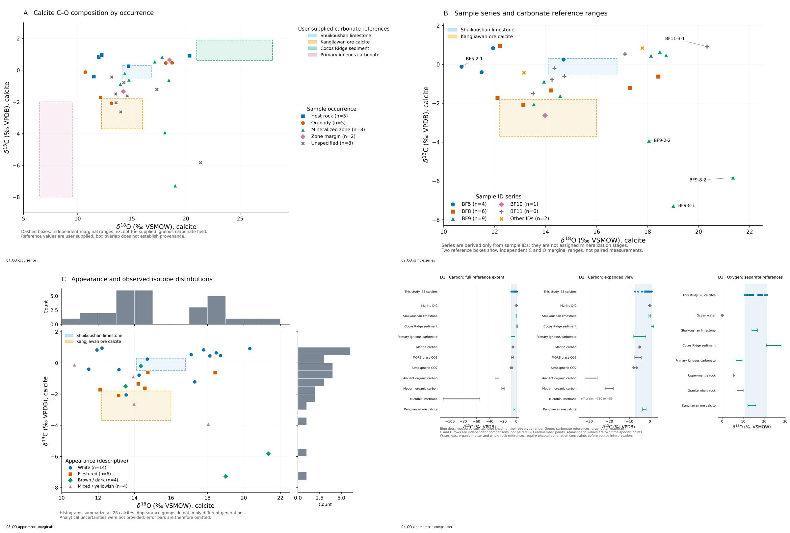

# 方解石 C–O 同位素图件

基于上传的 28 个方解石样品与 14 类端元参考资料，保存四张描述性图件及可复现代码。



- [四图合并 PDF](co_isotope_figures/CO_four_figures.pdf)
- [图 1：产出位置分组](co_isotope_figures/01_CO_occurrence.png)
- [图 2：样品编号分组](co_isotope_figures/02_CO_sample_series.png)
- [图 3：外观分组与边际分布](co_isotope_figures/03_CO_appearance_marginals.png)
- [图 4：端元碳、氧独立对比](co_isotope_figures/04_CO_endmember_comparison.png)
- [图注、数据核对与使用限制](co_isotope_figures/README_绘图说明.md)

每张图提供 600 dpi PNG、矢量 PDF 和可编辑 SVG。原始 CSV 副本、数据核对表和端元引用表均在 `co_isotope_figures/` 中。

## 复现

```bash
cd co_isotope_figures
python3 -m pip install -r requirements.txt
python3 plot_co.py
```

## 当前状态

这些是基于用户上传数据的初稿。上传的 skills ZIP 因超过工具的 32 MiB 传输限制而未读取；不少于 10 个顶刊原图的独立核查因网络访问限制而尚未完成。端元引文来自用户 CSV，未独立核验。水、气体、有机物和全岩参考分别展示，不视作可直接与方解石混合的二维端元；图件不提供来源定论或混合比例。
