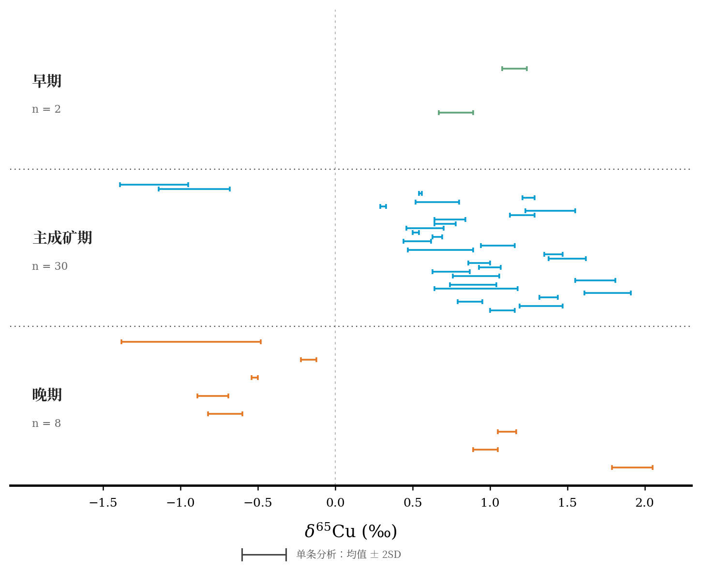

# 单矿床早—主—晚期铜同位素图

按用户第二张参考图的样式制作：横轴 δ⁶⁵Cu（‰），每条分析以水平 H 形误差棒表示，阶段之间使用点状横线分隔，保留粗底轴。这里只表示一个矿床，因此三个分组为**早期、主成矿期、晚期**，不是三个矿床。



- [中文高清 PNG](Cu_stages_CN.png) / [中文 PDF](Cu_stages_CN.pdf) / [中文 SVG](Cu_stages_CN.svg)
- [英文高清 PNG](Cu_stages_EN.png) / [英文 PDF](Cu_stages_EN.pdf) / [英文 SVG](Cu_stages_EN.svg)
- [截图转录数据](data_transcribed.csv)

## 数据处理

- 从用户第一张截图逐行转录了 40 条分析：早期 2、主成矿期 30、晚期 8。
- 每一行单独绘制，未因可见样品编号相同而合并。截图里的样品编号有截断，`sample_visible` 仅保留可见字符串，不视为完整唯一编号。
- 表中 `2SD` 按均值左右各一个所报 2SD 绘制，即 **δ⁶⁵Cu ± 2SD**；未将此列再除以 2。这个解释需要在正式使用前与原表表头确认。
- 早期依据“早期Bn”归组；其他阶段严格依据截图的“主成矿期”和“晚期”标注。“主成矿期 Bn 同位素”仍归为主成矿期。
- 每个阶段内从上到下保留截图顺序。纵向位置仅为排版，既不表示深度也不表示连续时间；各组带宽相同，不表示持续时间。
- 数据表保留可见深度；第 39 条 BF016-1- 深度空缺，不补值。深度没有参与本图坐标计算。
- 颜色按阶段区分：早期绿、主期蓝、晚期橙；没有从颜色反推矿物种类。截图中只对部分分析注明 Bn、Cv，未把全部数据强制分为某种矿物。
- 没有 δ⁶⁵Cu 标准物质说明，不自行补写 NIST 976 等标准名称。
- 未照搬参考图的“CC”灰带，因为用户没有提供该带的定义或范围。浅灰虚线仅标示 δ⁶⁵Cu=0‰，没有赋予其来源意义。
- 当前数据为**截图人工转录版**，不是原始 Excel 的直接读取版。论文正式使用前请用原始电子表格核对数值、阶段、完整编号及 2SD 含义。

## 建议图注

**中文：** 单矿床不同成矿阶段的铜同位素组成。每个水平误差棒表示截图中一条分析的 δ⁶⁵Cu 均值及所报 ±2SD；颜色分别表示早期（绿色，n=2）、主成矿期（蓝色，n=30）和晚期（橙色，n=8）。点状横线分隔阶段，阶段内纵向排列仅用于显示各条分析，不代表深度或连续时间。浅灰虚线为 δ⁶⁵Cu=0‰。

**English:** Copper isotope compositions of a single deposit grouped into early (green, n=2), main ore (blue, n=30), and late (orange, n=8) stages. Each horizontal bar represents one reported mean δ⁶⁵Cu value with ±2SD as transcribed from the supplied table. Dotted lines separate stages; vertical offsets within each stage are for display only and do not represent depth or a continuous chronology. The pale dashed line marks δ⁶⁵Cu=0‰.

## 复现

在具备 numpy、pandas、matplotlib 和 Noto Serif CJK 字体的环境中运行：

```bash
python3 plot_stages.py
```

`point_row_mapping.csv` 将图中的纵向位置映射回截图分析行号，便于核对。`stage_summary.csv` 为分组数量与实测 δ⁶⁵Cu 范围，不是分组均值或过程模型。
