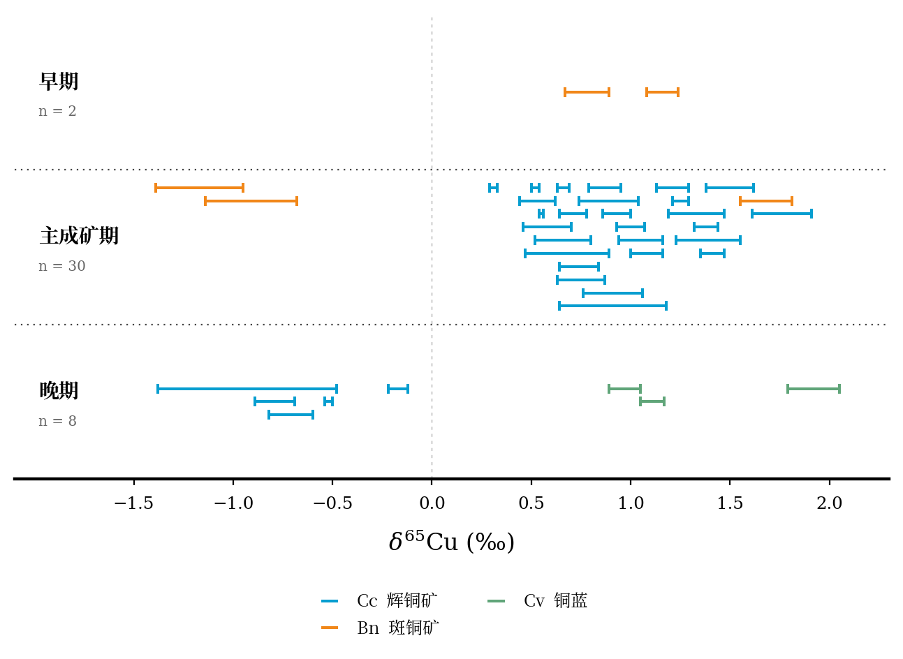

# 单矿床铜同位素：按矿物区分图例

上一版按阶段着色的铜同位素 PNG、PDF、SVG、预览图及旧绘图脚本已从仓库当前版本移除，替换为本版。早期、主成矿期、晚期仍以三个分区表示，**颜色和下方图例表示矿物及用户提供的矿物标签**。没有改动原先的 C–O 图件。



- [中文 PNG](Cu_minerals_CN.png) / [中文 PDF](Cu_minerals_CN.pdf) / [中文 SVG](Cu_minerals_CN.svg)
- [英文 PNG](Cu_minerals_EN.png) / [英文 PDF](Cu_minerals_EN.pdf) / [英文 SVG](Cu_minerals_EN.svg)
- [矿物分组数据](data_minerals.csv)
- [原截图转录数据](data_transcribed.csv)

## 根据用户回复确认的矿物分组

| 图例 | 条数 | 分析行号 | 依据 |
|---|---:|---|---|
| Cc，辉铜矿（蓝色） | 32 | 未注明矿物的其余行 | 用户确认其余 32 条均为 Cc |
| Bn，斑铜矿（橙色） | 5 | 2、3、28、29、30 | 原截图 Bn 及用户确认 BF5-5-2 两条为 Bn |
| Cv，铜蓝（绿色） | 3 | 35、36、37 | 原截图明确标出“打在Cv” |

BF5-5-2 两条已按用户最新确认统一标为 Bn，与其他斑铜矿共用图例；仍属于主成矿期。

## 数据与排版

- 共 40 条分析全部保留：早期 2、主成矿期 30、晚期 8。没有将可见编号重复的记录合并为均值。
- 每条 H 形水平误差棒表示 δ⁶⁵Cu 均值 ±2SD；截图中的 2SD 列作为误差半宽，未再次除以 2。
- 点状横线分隔阶段，粗底轴及下方矿物图例参照用户给出的图件样式。颜色表示矿物，不再表示成矿阶段。
- 同阶段内，不相交的误差区间可以共用一行；纵向位置仅用于排版，不表示深度或先后顺序。`point_row_mapping.csv` 将图中位置映射回原始截图行号。
- 没有照搬原图中定义未知的 CC 灰带。浅灰虚线仅表示 δ⁶⁵Cu=0‰，不代表某种来源范围。
- `sample_visible` 只保留截图可见编号片段。第 39 条深度缺失，不补值；深度不参与本图坐标计算。
- 原始测量值及阶段保存在 `data_transcribed.csv`；用户确认后的矿物分类及判定依据保存在 `data_minerals.csv`。脚本会核对两表的数值和阶段完全一致。
- δ⁶⁵Cu 的标准物质名称未提供，不自行补写。

## 建议图注

单矿床早期、主成矿期和晚期的铜同位素组成。每个 H 形水平误差棒表示一条分析的 δ⁶⁵Cu 均值 ±2SD；颜色分别表示 Cc（辉铜矿）、Bn（斑铜矿）和 Cv（铜蓝）。点状横线分隔阶段，纵向排列仅用于显示各条分析，不表示深度或连续时间。灰色竖虚线标示 δ⁶⁵Cu=0‰。

## 复现

在具备 numpy、pandas、matplotlib 和 Noto Serif CJK 字体的环境中运行：

```bash
python3 plot_minerals.py
```

程序生成中文和英文两个排版版本，各有 600 dpi PNG、矢量 PDF、可编辑 SVG 及预览图。测量数据来自截图人工转录，正式投稿前建议用原始电子表格核对。
